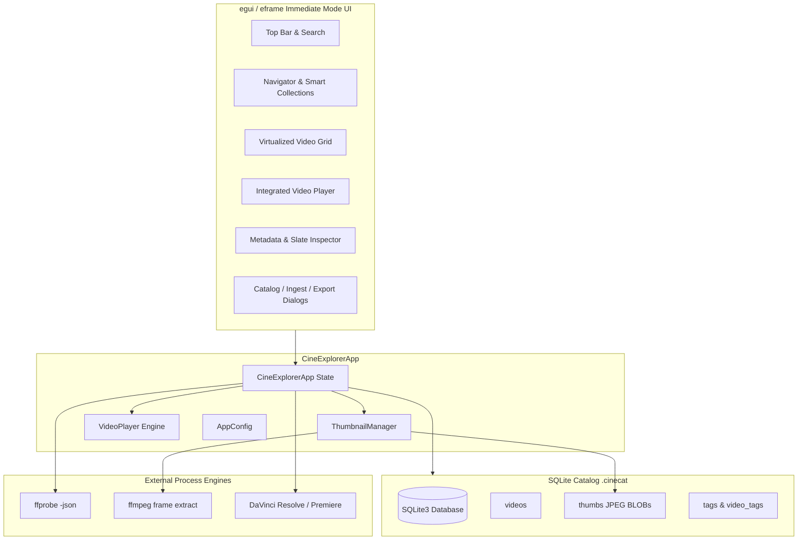

# AGENTS.md — Developer & AI Agent Guide for `cineExplorer`

Welcome to `cineExplorer`! This document serves as a comprehensive system guide, architectural reference, and operational playbook for AI coding agents and human contributors working on this codebase.

---

## 1. Project Mission & Scope

`cineExplorer` is a high-performance desktop video browser, catalog, and metadata inspector written in **Rust**. While inspired by `mlvExplorer` (which was dedicated solely to Magic Lantern RAW `.mlv` videos), `cineExplorer` is built from the ground up to support **all modern commercial and cinema video formats** used in professional film and video production environments:

- **Containers**: MP4, MOV, BRAW (Blackmagic RAW), MKV, MXF, AVI, WebM, M4V, TS, MTS.
- **Codecs**: Apple ProRes (all profiles), H.265 / HEVC, H.264 / AVC, Blackmagic RAW (BRAW), Avid DNxHD/DNxHR, AV1, VP9.
- **Bit Depths**: 8-bit, 10-bit, and 12-bit deep color.
- **Color Spaces**: Rec.709, Rec.2020, DCI-P3, HDR10 (PQ), HLG, and camera Log curves.
- **NLE Integration**: Direct project generation for **DaVinci Resolve** (`.fcpxml` with keyword smart bins) and **Adobe Premiere Pro** (`.xml`), plus metadata CSV interchange.

---

## 2. Architecture & System Design



### Key Architectural Concepts

1. **Standalone SQLite Catalogs (`.cinecat`)**:
   - Each catalog is an isolated SQLite database file.
   - Initialized with `PRAGMA journal_mode = WAL;`, `PRAGMA synchronous = NORMAL;`, and `PRAGMA foreign_keys = ON;`.
   - Indexed on `codec`, `container`, `bit_depth`, `camera_model`, `rating`, `flag`, and `date_recorded`.

2. **Loose-Coupling Media Engine (FFmpeg & FFprobe)**:
   - Probing and frame extraction are performed via spawned child processes (`std::process::Command`).
   - **Crucial Rule on Windows**: All spawned commands *must* use `apply_no_window(&mut cmd)` from `crate::media::apply_no_window` to set `CREATE_NO_WINDOW = 0x08000000`, preventing flickering console windows.
   - Communication uses JSON output for metadata inspection (`-print_format json`) and standard output pipes (`pipe:1`) for thumbnail and playback frame JPEG byte streams.

3. **Multi-Threaded Asynchronous Workers**:
   - Long-running or heavy operations (recursive directory crawling, metadata probing, thumbnail rendering, audio decoding) run on worker threads using `crossbeam_channel`.
   - The main UI thread only receives completed events, keeping the interface fluid at 60+ FPS.

4. **NLE Interchange Architecture (`src/export/`)**:
   - **DaVinci Resolve (`resolve_fcpxml.rs`)**: Exports FCPXML 1.9 with `<keyword value="..."/>` tags inside `<ref-clip>` elements. Resolve converts these into **Keyword Smart Bins**.
   - **Adobe Premiere Pro (`premiere_xml.rs`)**: Exports FCP 7 XML (`<xmeml version="5">`) with project bins, sequence tracks, logging info, and keyword log notes.
   - **Resolve Media Pool CSV (`metadata_csv.rs`)**: Native CSV format for `File > Import > Media Pool Metadata...`.

---

## 3. Codebase Directory Map

```text
d:\Dev\githubprojects\cineExplorer/
├── .github/
│   └── workflows/
│       ├── ci.yml              # Multi-OS build, clippy, and unit test pipeline
│       └── release.yml         # Automated multi-platform release asset builder
├── src/
│   ├── main.rs                 # eframe entry point & native viewport configuration
│   ├── app.rs                  # CineExplorerApp: orchestrates UI, shortcuts, state
│   ├── config.rs               # JSON config for persistent user preferences
│   ├── db/
│   │   ├── mod.rs              # Database wrapper struct
│   │   ├── models.rs           # VideoRecord, PickFlag, SmartCollection, Tag models
│   │   ├── queries.rs          # SQL queries, filtering, sorting, and catalog stats
│   │   └── schema.rs           # DDL schema setup and migration versioning
│   ├── media/
│   │   ├── mod.rs              # Extensions list and apply_no_window helper
│   │   ├── probe.rs            # ffprobe JSON extractor for technical & EXIF metadata
│   │   ├── thumbnailer.rs      # ffmpeg JPEG frame extraction for thumbnail caching
│   │   └── player_source.rs    # Video frame seek engine for player and scrubber
│   ├── export/
│   │   ├── mod.rs              # NleTarget enum, options, and export_and_launch
│   │   ├── resolve_fcpxml.rs   # FCPXML 1.9 generator with keywords & slate
│   │   ├── premiere_xml.rs     # FCP 7 XML generator for Premiere Pro & Resolve
│   │   ├── metadata_csv.rs     # DaVinci Resolve Media Pool CSV exporter
│   │   └── launcher.rs         # NLE detection (Resolve / Premiere) and execution
│   ├── importer.rs             # Multi-threaded background crawler for in-place import
│   ├── ingester.rs             # Multi-threaded SD card & camera media offloader and ingester
│   ├── playback.rs             # Video player engine, read-ahead, and playhead sync
│   ├── thumbnails.rs           # Thumbnail texture manager and SQLite cache sync
│   └── ui/
│       ├── mod.rs              # UI layout coordinator
│       ├── theme.rs            # Cinematic dark palette, font definitions, and badges
│       ├── widgets.rs          # Star rating, pick/reject buttons, color swatches
│       ├── top_bar.rs          # Header toolbar with search, filters, zoom, export
│       ├── navigator.rs        # Sidebar smart collections, formats, codecs, tags
│       ├── grid/               # Virtualized video cards with hover scrubber
│       ├── inspector/          # Collapsible tech specs, camera EXIF, slate, notes
│       ├── player/             # Integrated video player viewport & transport controls
│       └── dialogs/            # Ingest, Import, Catalog, Delete, and Export modal windows
├── Cargo.toml                  # Dependencies, profiles, and package metadata
├── LICENSE                     # MIT License
├── NOTICE                      # Legal open-source attribution notice
├── THIRD_PARTY_LICENSES.md     # Full third-party open source compliance inventory
└── README.md                   # User-facing manual and feature documentation
```

---

## 4. Coding Standards & Agent Invariants

When modifying or adding code to this project, adhere to these guidelines:

### A. Borrow Checker Discipline
- In `app.rs`, avoid holding an immutable borrow of `self` (such as `self.selected_video()`) across mutable calls to fields like `self.thumb_mgr`, `self.edit_*`, or dialog states.
- Pattern: Clone the video item or ID first (`let sel = self.selected_video().cloned();`) so that references to `self` are dropped before passing mutable references to sub-components.

### B. Subprocess Execution on Windows
- Always call `apply_no_window(&mut cmd)` on every `std::process::Command` created.
- Without this, console command prompt windows will briefly pop up during thumbnail generation and file probing on Windows.

### C. NLE Keyword Mapping
- When adding new metadata or attributes to `VideoRecord`, consider whether they should be exposed as keywords in the NLE export.
- Standard keywords injected by `resolve_fcpxml.rs`:
  - Bit depth: `"10-bit"`, `"12-bit"`, `"8-bit"`
  - Resolution label: `"4K UHD"`, `"1080p"`, `"8K"`, etc.
  - Codec display name: `"ProRes HQ"`, `"H.265 / HEVC"`, `"Blackmagic RAW"`, etc.
  - Camera make/model: `"Sony FX3"`, `"BMPCC 6K"`, etc.
  - Flag status: `"Pick"`, `"Reject"`
  - Star rating: `"5 Stars"`, etc.
  - User tags: exact tag names.

### D. SQLite Migrations
- Keep all database schema alterations additive in `src/db/schema.rs`.
- Use `CREATE TABLE IF NOT EXISTS` and `CREATE INDEX IF NOT EXISTS`.
- For new columns, execute `ALTER TABLE videos ADD COLUMN ...` inside migration loops, ignoring duplicate column errors.

---

## 5. Build, Test & Verification Commands

AI agents should verify their modifications with these commands:

```bash
# 1. Quick check for compilation errors and type safety
cargo check --all-targets

# 2. Run all unit and integration tests
cargo test --all-targets --verbose

# 3. Check for linter warnings
cargo clippy --all-targets -- -D warnings

# 4. Build debug executable
cargo build

# 5. Build optimized release executable
cargo build --release
```
